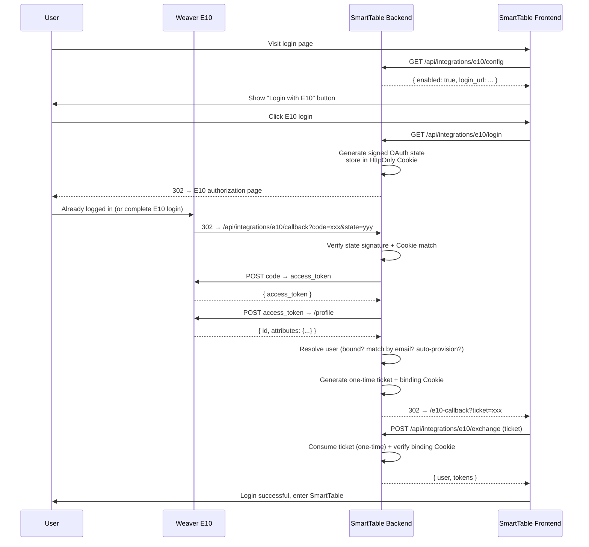

# Weaver E10 Single Sign-On Integration

This document describes how to integrate SmartTable with Weaver E10/OA OAuth2 Single Sign-On. After integration, users can navigate to SmartTable directly from the E10 portal without entering credentials again.

---

## 1. Features

### Capabilities

| Feature | Description |
|---------|-------------|
| **OAuth2 Authorization Code Flow** | Users authenticated in E10 click the SmartTable app icon and are logged in automatically |
| **Auto-provisioning** | E10 users are created in SmartTable on first login |
| **Account binding** | Match existing SmartTable users by E10 user ID or email |
| **Profile sync** | Optionally sync display name and avatar |
| **Logout chaining** | SmartTable logout also terminates the E10 session |
| **Enforce SSO mode** | When enabled, local password login is completely disabled |

### Security Design

- **OAuth state double-check**: Signature + HttpOnly Cookie prevents CSRF attacks
- **One-time ticket**: Short-lived ticket exchanged for JWT avoids exposing tokens in the URL bar
- **Binding cookie**: Ticket is bound to the originating browser, preventing stolen tickets from being used elsewhere
- **Redis-first with memory fallback**: Nonce consumption works with Redis across multiple processes; falls back to in-process memory when Redis is unavailable

### Zero Impact When Disabled

The integration lives in a dedicated module and does not touch upstream business modules:

- When `E10_SSO_ENABLED` is not set or is `false`, no routes are registered and no E10 button appears on the login page
- No changes to the existing `users` table — E10 identity bindings live in a separate `e10_sso_identities` table
- Works with both SQLite and PostgreSQL

---

## 2. E10 Side Configuration

> E10 Docmount：https://weapp.eteams.cn/sp/ebdpage/view/freepass/1152863419640021002/page/1152863419640021002?id=1177708516831125564&space_id=1158011075224911873&freepass_doc=1

### 2.1 Create OAuth2 Application

Log in to the E10 admin console, navigate to **Integration Center → OAuth2 Management → Application Management**, and create a new application:

| Setting | Value | Description |
|---------|-------|-------------|
| **Application Name** | SmartTable (or custom) | Displayed on the E10 portal |
| **Grant Type** | Authorization Code | |
| **Redirect URI** | `https://<your-smarttable-domain>/api/integrations/e10/callback` | **Must exactly match `E10_REDIRECT_URI` in SmartTable config** |
| **ID Mapping Rule** | Recommend "Job Number" or "Email" | Determines what the `id` field in E10 `/profile` represents |
| **Custom Attributes** | Enable; return name, mobile, email | Used to populate user profile during auto-provisioning |

Record the **Client ID** and **Client Secret** after creation.

### 2.2 Redirect URI Requirements

The redirect URI must satisfy the following conditions, otherwise E10 returns `80013 redirect_mismatch`:

- Protocol, domain, and port must exactly match `E10_REDIRECT_URI`
- No `#` fragment anchors
- Must use HTTPS in production

---

## 3. SmartTable Side Configuration

### 3.1 Docker Deployment

Edit `docker-compose.full.yml` and add under the backend service's `environment`:

```yaml
services:
  smarttable-backend:
    environment:
      # ---- E10 SSO Settings ----
      E10_SSO_ENABLED: "true"                                      # Enable switch
      E10_BASE_URL: "https://oa.yourcompany.com.cn:20600"          # E10 base URL
      E10_CLIENT_ID: "xxxxxxxx-xxxx-xxxx-xxxx-xxxxxxxxxxxx"         # E10 Client ID
      E10_CLIENT_SECRET: "xxxxxxxxxxxxxxxxxxxxxxxxxxxx"             # E10 Client Secret

      # Addresses (explicitly configure in production to avoid proxy http/https issues)
      E10_REDIRECT_URI: "https://smarttable.yourcompany.com.cn/api/integrations/e10/callback"
      E10_FRONTEND_BASE_URL: "https://smarttable.yourcompany.com.cn"

      # User mapping
      E10_ID_FIELD: "job_num"                                       # Match E10 mapping rule
      E10_EMAIL_TEMPLATE: "{job_num}@yourcompany.com"               # Email generation for auto-provisioning
      E10_EMAIL_FALLBACK_TEMPLATE: "{id}@yourcompany.com"
      E10_AUTO_CREATE_USERS: "true"                                 # Auto-create new users on first login
      E10_MATCH_BY_EMAIL: "true"                                    # Match existing users by email first
      E10_SYNC_PROFILE: "true"                                      # Sync name and avatar on login

      # Roles
      E10_DEFAULT_ROLE: "editor"                                    # Default role for auto-provisioned users
      E10_ADMIN_IDS: "ADMIN001,ADMIN002"                            # Admin whitelist (job number or E10 ID)

      # Security
      E10_PASSWORD_LOGIN_ENABLED: "true"                            # Keep local password login available
      E10_ENFORCE_SSO: "false"                                      # true = fully disable local login/register
      E10_LOGOUT_WITH_E10: "true"                                   # Log out of E10 on SmartTable logout
```

Restart the backend container:

```bash
docker-compose -f docker-compose.full.yml up -d smarttable-backend
```

### 3.2 Local Development / Non-Docker

Set environment variables before starting the backend (PowerShell example):

```powershell
$env:E10_SSO_ENABLED = "true"
$env:E10_BASE_URL = "https://oa.yourcompany.com.cn:20600"
$env:E10_CLIENT_ID = "xxxxxxxx-xxxx-xxxx-xxxx-xxxxxxxxxxxx"
$env:E10_CLIENT_SECRET = "xxxxxxxxxxxxxxxxxxxxxxxxxxxx"
$env:E10_REDIRECT_URI = "http://localhost:5000/api/integrations/e10/callback"
$env:E10_FRONTEND_BASE_URL = "http://localhost:5173"
python run.py
```

Or configure them in a `.env` file.

### 3.3 Required and Optional Settings

| Variable | Required | Default | Description |
|----------|----------|---------|-------------|
| `E10_SSO_ENABLED` | Yes | `false` | Master switch |
| `E10_BASE_URL` | Yes | — | E10 base URL, e.g. `https://oa.xxx.com.cn:20600` |
| `E10_CLIENT_ID` | Yes | — | E10 application Client ID |
| `E10_CLIENT_SECRET` | Yes | — | E10 application Client Secret |
| `E10_REDIRECT_URI` | Recommended | Auto-derived | OAuth callback URL — **must be explicit in production** |
| `E10_FRONTEND_BASE_URL` | Recommended | Auto-derived | Frontend base URL for post-SSO redirect |
| `E10_ID_FIELD` | No | `loginId` | Field corresponding to E10's account mapping rule |
| `E10_EMAIL_TEMPLATE` | No | — | Email template for auto-provisioning, supports `{id}`, `{job_num}`, `{username}`, `{mobile}`, `{domain}` |
| `E10_AUTO_CREATE_USERS` | No | `true` | Auto-create users on first login |
| `E10_DEFAULT_ROLE` | No | `editor` | Default role for auto-provisioned users (`viewer`/`commenter`/`editor`) |
| `E10_ADMIN_IDS` | No | — | Admin whitelist, comma-separated, accepts E10 user ID or job number |
| `E10_MATCH_BY_EMAIL` | No | `true` | Match existing users by email before auto-provisioning |
| `E10_PASSWORD_LOGIN_ENABLED` | No | `true` | Show local password login form on login page |
| `E10_ENFORCE_SSO` | No | `false` | If `true`, server disables `/api/auth/login` and `/api/auth/register` |
| `E10_LOGOUT_WITH_E10` | No | `true` | Also log out of E10 when SmartTable logs out |
| `E10_VERIFY_SSL` | No | `true` | Verify E10 HTTPS certificates |
| `E10_TIMEOUT` | No | `15` | HTTP call timeout in seconds |

---

## 4. Email Template Reference

When E10 does not return an email field, SmartTable generates one via template. Supported placeholders:

| Placeholder | Source |
|-------------|--------|
| `{id}` | E10 `/profile` user identifier |
| `{login_id}` | Same as `{id}` |
| `{job_num}` | E10 custom attribute job number (aliases: `jobNum`, `job_number`) |
| `{username}` | E10 custom attribute display name (aliases: `user_name`, `name`, `cn`) |
| `{mobile}` | E10 custom attribute phone (aliases: `phone`, `phone_number`) |
| `{domain}` | Value of `E10_EMAIL_DOMAIN` |

Resolution order:

1. Email / mail attribute directly from E10
2. `E10_EMAIL_TEMPLATE` (first template that resolves successfully)
3. `E10_EMAIL_FALLBACK_TEMPLATE`
4. `{id}@{E10_EMAIL_DOMAIN}` concatenation
5. Fails with error — SSO login rejected

**Recommended configuration**:

```
E10_EMAIL_TEMPLATE={job_num}@yourcompany.com
E10_EMAIL_FALLBACK_TEMPLATE={id}@yourcompany.com
```

---

## 5. API Endpoints

| Method | Path | Description |
|--------|------|-------------|
| GET | `/api/integrations/e10/config` | Frontend reads E10 SSO state; no secrets exposed |
| GET | `/api/integrations/e10/login` | Generates OAuth state and 302s to E10 authorization page |
| GET | `/api/integrations/e10/callback` | E10 callback (**must exactly match E10's registered redirect_uri**) |
| POST | `/api/integrations/e10/exchange` | Frontend exchanges one-time ticket for SmartTable JWT |
| GET | `/api/integrations/e10/logout` | Terminates E10 session and returns to login page |

---

## 6. Login Flow



---

## 7. Troubleshooting

### No E10 button on login page

Open browser devtools and inspect `GET /api/integrations/e10/config`:

| Response | Meaning |
|----------|---------|
| `enabled: false` | `E10_SSO_ENABLED` is not set or is `false` |
| `enabled: true, ready: false` | Required settings are missing (check backend logs for warnings) |

Check backend logs for:
```
[E10] E10_SSO_ENABLED=true but missing required settings: E10_CLIENT_ID
```

### `redirect_mismatch` / `80013` after E10 callback

E10's registered redirect URI does not match SmartTable's.

1. Confirm E10 redirect URI = `E10_REDIRECT_URI`
2. Protocol (http/https), domain, port, and path must match exactly
3. In reverse proxy setups, always set `E10_REDIRECT_URI` explicitly — do not rely on auto-derivation

### `state_expired` / `state_missing` after E10 callback

- `state_missing`: Browser or proxy dropped the HttpOnly Cookie `e10_oauth_state`. Check if your proxy strips Cookie headers.
- `state_expired`: User spent too long on the E10 authorization page. Default state TTL is 600 seconds; adjust with `E10_STATE_TTL`.

### `email_not_configured` after E10 callback

E10 did not return an email field and SmartTable cannot auto-generate one.

Configure either:
- `E10_EMAIL_TEMPLATE={job_num}@yourcompany.com`
- `E10_EMAIL_DOMAIN=yourcompany.com`

### Frontend shows `ticket_invalid` / `ticket_used`

- Opened the callback link in a different browser (binding Cookie mismatch)
- Ticket was already consumed (one-time use)
- Redis is unavailable in a multi-process deployment, causing inconsistent ticket storage (check backend logs for Redis fallback warnings)

### User not auto-provisioned on first login

- Check that `E10_AUTO_CREATE_USERS` is `true`
- Verify `E10_EMAIL_TEMPLATE` / `E10_EMAIL_DOMAIN` can generate a valid email
- If E10's mapping rule returns something other than login ID, confirm `E10_ID_FIELD` matches

### E10 session remains active after SmartTable logout

Set `E10_LOGOUT_WITH_E10=true` (enabled by default). SmartTable redirects to E10's logout endpoint before returning to the login page. Set to `false` to preserve the E10 session.

---

## 8. Security & Operational Checklist

### Must Do in Production

1. **Set `E10_REDIRECT_URI` explicitly**: Reverse proxy / load balancer environments may break auto-derivation
2. **Use HTTPS**: Both callback URL and frontend must use HTTPS; Cookies are automatically marked Secure
3. **Enable Redis**: Multi-process deployments require Redis for one-time ticket storage; in-process memory fallback is single-process only
4. **Use `E10_ADMIN_IDS` for admin users**: Don't auto-provision all E10 users as editors
5. **Back up `e10_sso_identities`**: Identity bindings must survive migrations

### When Disabling

- Remove `E10_SSO_ENABLED` or set to `false`, restart — SmartTable returns to local-login-only mode
- Existing SmartTable users are unaffected; the `e10_sso_identities` table persists
- To clean up bindings entirely, `DROP TABLE e10_sso_identities` manually

---
