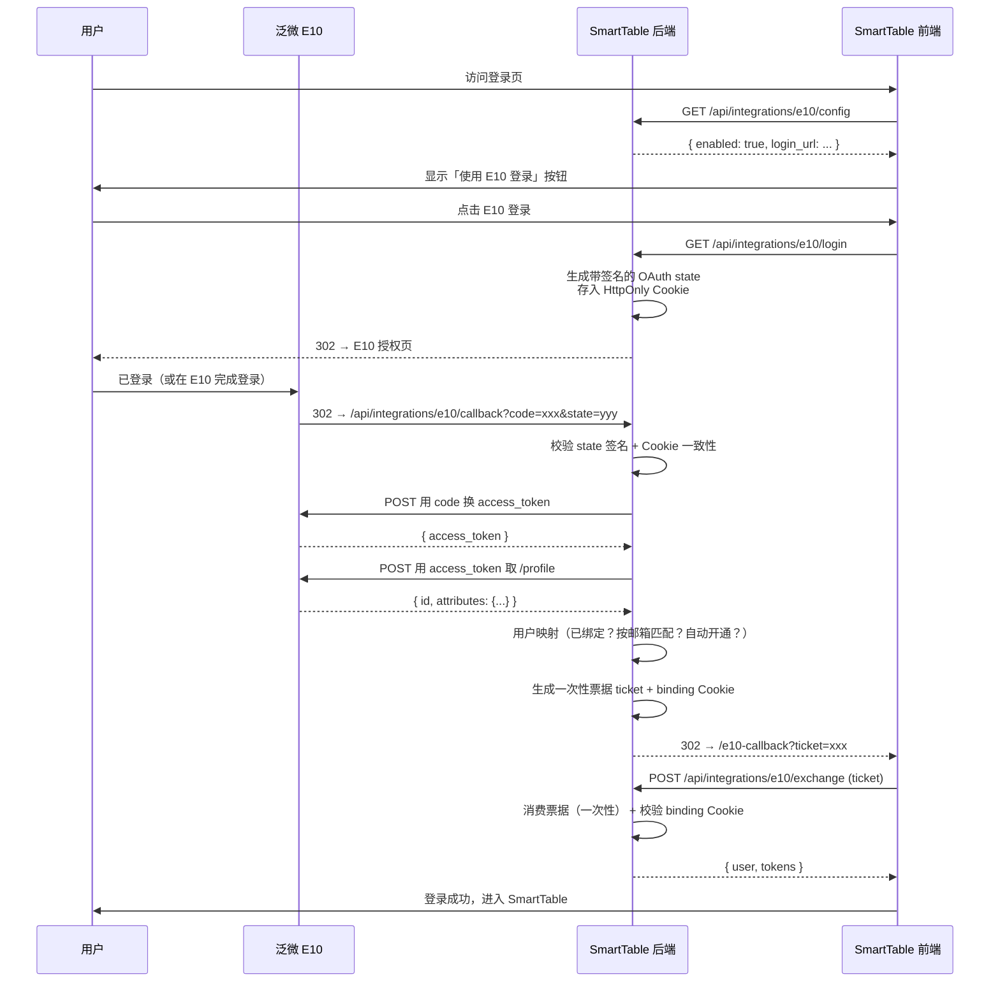

# 泛微 E10 单点登录集成

本文档介绍如何将 SmartTable 与泛微 E10/OA 的 OAuth2 单点登录集成。集成后，用户可以通过 E10 门户直接跳转到 SmartTable，无需再次输入账号密码。

---

## 1. 功能概览

### 支持的能力

| 能力 | 说明 |
|------|------|
| **OAuth2 授权码模式登录** | 用户在 E10 登录后，点击 SmartTable 应用图标自动完成登录 |
| **自动开通账号** | E10 人员首次进入 SmartTable 时自动创建对应账号 |
| **账号绑定** | 通过 E10 用户 ID 或邮箱匹配已有的 SmartTable 用户 |
| **同步用户信息** | 可选同步姓名、头像等资料 |
| **登出联动** | SmartTable 登出时同时注销 E10 会话 |
| **强制 SSO 模式** | 开启后禁用本地密码登录，仅允许 E10 SSO |

### 安全设计

- **OAuth state 双检**：state 参数签名存储 + HttpOnly Cookie 双重校验，防止 CSRF
- **一次性票据**：回调后使用短时票据换取 JWT，避免 URL 栏暴露 Token
- **绑定 Cookie**：票据绑定浏览器会话，防止票据被盗用后在其他浏览器登录
- **Redis 优先 + 内存回退**：一次性票据 nonce 消费支持 Redis 多进程部署，无 Redis 时自动回退进程内内存

### 不影响现有功能

集成完全独立于业务模块：

- 未配置或关闭 `E10_SSO_ENABLED` 时，后端不注册任何路由，前端登录页不显示 E10 按钮
- 不修改现有 `users` 表结构，E10 身份映射存放在独立的 `e10_sso_identities` 表中
- SQLite 与 PostgreSQL 双环境均兼容

---

## 2. E10 端配置

> E10 文档地址：https://weapp.eteams.cn/sp/ebdpage/view/freepass/1152863419640021002/page/1152863419640021002?id=1177708516831125564&space_id=1158011075224911873&freepass_doc=1

### 2.1 创建 OAuth2 应用

登录 E10 后台，进入 **集成中心 → OAuth2 管理 → 应用管理**，创建新应用：

| 配置项 | 值 | 说明 |
|--------|------|------|
| **应用名称** | SmartTable（或自定义） | E10 门户上显示的应用名 |
| **授权类型** | 授权码（Authorization Code） | |
| **回调地址 (redirect_uri)** | `https://<你的-smarttable-域名>/api/integrations/e10/callback` | **必须与 SmartTable 配置中的 `E10_REDIRECT_URI` 完全一致** |
| **账号映射规则** | 建议选「工号」或「电子邮箱」 | 决定 E10 `/profile` 返回的 `id` 字段含义 |
| **自定义属性** | 建议开启，返回姓名、手机号、邮箱 | 用于 SmartTable 自动开通时填充用户资料 |

创建后记录 **Client ID** 和 **Client Secret**。

### 2.2 回调地址要求

回调地址必须满足以下条件，否则 E10 会返回 `80013 redirect_mismatch`：

- 协议、域名、端口必须与配置的 `E10_REDIRECT_URI` 完全一致
- 不能包含 `#` 锚点
- 必须走 HTTPS（生产环境）

---

## 3. SmartTable 端配置

### 3.1 Docker 部署

编辑 `docker-compose.full.yml`，在后端服务的 `environment` 下添加：

```yaml
services:
  smarttable-backend:
    environment:
      # ---- E10 SSO 配置 ----
      E10_SSO_ENABLED: "true"                                    # 启用开关
      E10_BASE_URL: "https://oa.yourcompany.com.cn:20600"        # E10 访问地址
      E10_CLIENT_ID: "xxxxxxxx-xxxx-xxxx-xxxx-xxxxxxxxxxxx"     # E10 应用 Client ID
      E10_CLIENT_SECRET: "xxxxxxxxxxxxxxxxxxxxxxxxxxxx"         # E10 应用 Client Secret

      # 地址（生产环境务必显式配置，避免反向代理导致 http/https 混淆）
      E10_REDIRECT_URI: "https://smarttable.yourcompany.com.cn/api/integrations/e10/callback"
      E10_FRONTEND_BASE_URL: "https://smarttable.yourcompany.com.cn.cn"

      # 用户映射
      E10_ID_FIELD: "job_num"                                   # 与 E10 账号映射规则对应
      E10_EMAIL_TEMPLATE: "{job_num}@yourcompany.com"            # 自动开通时生成邮箱
      E10_EMAIL_FALLBACK_TEMPLATE: "{id}@yourcompany.com"        # 模板解析失败时的回退
      E10_AUTO_CREATE_USERS: "true"                              # 自动开通新用户
      E10_MATCH_BY_EMAIL: "true"                                 # 优先按邮箱匹配已有用户
      E10_SYNC_PROFILE: "true"                                   # 登录时同步姓名、头像

      # 角色
      E10_DEFAULT_ROLE: "editor"                                 # 自动开通的默认角色
      E10_ADMIN_IDS: "ADMIN001,ADMIN002"                         # 管理员白名单（工号或 E10 ID）

      # 安全
      E10_PASSWORD_LOGIN_ENABLED: "true"                         # 同时保留本地密码登录
      E10_ENFORCE_SSO: "false"                                   # 为 true 则完全禁用本地登录/注册
      E10_LOGOUT_WITH_E10: "true"                                # 登出时联动注销 E10 会话
```

修改后重启后端容器：

```bash
docker-compose -f docker-compose.full.yml up -d smarttable-backend
```

### 3.2 本地开发 / 非 Docker 部署

在启动后端前设置环境变量（PowerShell 示例）：

```powershell
$env:E10_SSO_ENABLED = "true"
$env:E10_BASE_URL = "https://oa.yourcompany.com.cn:20600"
$env:E10_CLIENT_ID = "xxxxxxxx-xxxx-xxxx-xxxx-xxxxxxxxxxxx"
$env:E10_CLIENT_SECRET = "xxxxxxxxxxxxxxxxxxxxxxxxxxxx"
$env:E10_REDIRECT_URI = "http://localhost:5000/api/integrations/e10/callback"
$env:E10_FRONTEND_BASE_URL = "http://localhost:5173"
python run.py
```

或在 `.env` 文件中逐条配置。

### 3.3 必填项与可选项

| 环境变量 | 必填 | 默认值 | 说明 |
|---------|------|--------|------|
| `E10_SSO_ENABLED` | 是 | `false` | 总开关 |
| `E10_BASE_URL` | 是 | — | E10 根地址，如 `https://oa.xxx.com.cn:20600` |
| `E10_CLIENT_ID` | 是 | — | E10 应用 Client ID |
| `E10_CLIENT_SECRET` | 是 | — | E10 应用 Client Secret |
| `E10_REDIRECT_URI` | 建议 | 自动推导 | OAuth 回调地址，生产环境**必须显式配置** |
| `E10_FRONTEND_BASE_URL` | 建议 | 自动推导 | 前端地址，用于 SSO 完成后跳转 |
| `E10_ID_FIELD` | 否 | `loginId` | E10 账号映射规则对应的字段 |
| `E10_EMAIL_TEMPLATE` | 否 | — | 自动开通用户时的邮箱模板，支持 `{id}`、`{job_num}`、`{username}`、`{mobile}`、`{domain}` |
| `E10_AUTO_CREATE_USERS` | 否 | `true` | 首次登录时是否自动创建用户 |
| `E10_DEFAULT_ROLE` | 否 | `editor` | 自动开通用户的默认角色（`viewer`/`commenter`/`editor`） |
| `E10_ADMIN_IDS` | 否 | — | 管理员白名单，逗号分隔，支持 E10 用户 ID 或工号 |
| `E10_MATCH_BY_EMAIL` | 否 | `true` | 自动开通前是否先按邮箱匹配已有用户 |
| `E10_PASSWORD_LOGIN_ENABLED` | 否 | `true` | 登录页是否显示本地密码登录表单 |
| `E10_ENFORCE_SSO` | 否 | `false` | 是否强制仅允许 SSO（服务端禁用 `/api/auth/login` 和 `/api/auth/register`） |
| `E10_LOGOUT_WITH_E10` | 否 | `true` | 登出时是否同时注销 E10 会话 |
| `E10_VERIFY_SSL` | 否 | `true` | 是否校验 E10 HTTPS 证书 |
| `E10_TIMEOUT` | 否 | `15` | E10 HTTP 调用超时（秒） |

---

## 4. 用户邮箱模板说明

当 E10 未返回邮箱字段时，SmartTable 通过模板自动生成。模板支持以下占位符：

| 占位符 | 来源 |
|--------|------|
| `{id}` | E10 `/profile` 返回的用户标识 |
| `{login_id}` | 同 `{id}` |
| `{job_num}` | E10 自定义属性中的工号（别名 `jobNum`、`job_number`） |
| `{username}` | E10 自定义属性中的姓名（别名 `user_name`、`name`、`cn`） |
| `{mobile}` | E10 自定义属性中的手机号（别名 `phone`、`phone_number`） |
| `{domain}` | `E10_EMAIL_DOMAIN` 环境变量的值 |

模板解析优先级：

1. E10 直接返回的 `email` / `mail` 属性
2. `E10_EMAIL_TEMPLATE` 模板（首个解析成功的）
3. `E10_EMAIL_FALLBACK_TEMPLATE` 模板
4. `{id}@{E10_EMAIL_DOMAIN}` 拼接
5. 都没有则返回错误，SSO 登录失败

**推荐配置**：

```
E10_EMAIL_TEMPLATE={job_num}@yourcompany.com
E10_EMAIL_FALLBACK_TEMPLATE={id}@yourcompany.com
```

---

## 5. 接口端点

| 方法 | 路径 | 说明 |
|------|------|------|
| GET | `/api/integrations/e10/config` | 前端读取 E10 SSO 开关状态，不暴露密钥 |
| GET | `/api/integrations/e10/login` | 生成 OAuth state 并 302 到 E10 授权页 |
| GET | `/api/integrations/e10/callback` | E10 回调端点（**必须与 E10 注册的 redirect_uri 完全一致**） |
| POST | `/api/integrations/e10/exchange` | 前端用一次性票据换取 SmartTable JWT |
| GET | `/api/integrations/e10/logout` | 注销 E10 会话并回到登录页 |

---

## 6. 登录流程



---

## 7. 常见问题排查

### 后端启动无异常，但登录页不显示 E10 按钮

打开浏览器开发者工具，访问 `GET /api/integrations/e10/config`：

| 返回值 | 含义 |
|--------|------|
| `enabled: false` | `E10_SSO_ENABLED` 未设置或为 `false` |
| `enabled: true, ready: false` | 必填项缺失（看后端日志中的 warning） |

检查后端日志中是否有：
```
[E10] E10_SSO_ENABLED=true 但缺少必填配置：E10_CLIENT_ID
```

### E10 回跳后报错 `redirect_mismatch` / `80013`

E10 注册的回调地址与 SmartTable 实际跳转地址不一致。

1. 确认 E10 注册的回调地址 = `E10_REDIRECT_URI`
2. 协议（http/https）、域名、端口、路径必须完全一致
3. 反向代理场景务必显式设置 `E10_REDIRECT_URI`，不要依赖自动推导

### E10 回跳后报错 `state_expired` / `state_missing`

- `state_missing`：浏览器或反向代理丢弃了 HttpOnly Cookie `e10_oauth_state`。检查代理是否剥离了 Cookie 头。
- `state_expired`：用户在 E10 授权页停留太久。默认 state TTL 为 600 秒，可通过 `E10_STATE_TTL` 调整。

### 用户回跳后报错 `email_not_configured`

E10 未返回邮箱字段，且 SmartTable 也无法自动生成邮箱。

配置任一即可：
- `E10_EMAIL_TEMPLATE={job_num}@yourcompany.com`
- `E10_EMAIL_DOMAIN=yourcompany.com`

### 前端提示 `ticket_invalid` / `ticket_used`

- 在不同浏览器打开了 E10 回调链接（票据绑定 Cookie 不匹配）
- 票据已被消费（同一票据不能兑换两次）
- Redis 不可用导致多进程部署时票据存储不一致（查看后端日志中的 Redis 回退警告）

### 用户首次登录没有自动开通

- 检查 `E10_AUTO_CREATE_USERS` 是否为 `true`
- 检查 `E10_EMAIL_TEMPLATE` / `E10_EMAIL_DOMAIN` 是否能生成有效邮箱
- E10 人员账号映射规则如果选了"登录 ID"但实际返回工号，会导致匹配失败，确认 `E10_ID_FIELD` 与 E10 配置一致

### 登出后还在 E10 保持登录状态

设置 `E10_LOGOUT_WITH_E10=true`（默认就是开启的）。登出时 SmartTable 会先跳转 E10 注销端点，再回到前端登录页。如需保留 E10 登录态，设为 `false`。

---

## 8. 安全与运维建议

### 生产环境必做

1. **显式配置 `E10_REDIRECT_URI`**：反向代理/负载均衡场景下自动推导可能出错
2. **使用 HTTPS**：回调地址和前端地址必须走 HTTPS，Cookie 会自动标记 Secure
3. **启用 Redis**：多进程部署时必须用 Redis 存储一次性票据，否则回退到内存会导致票据在进程间不一致
4. **使用 `E10_ADMIN_IDS` 指定管理员**：不要让 E10 所有用户都默认开通成 editor
5. **备份 `e10_sso_identities` 表**：迁移时身份绑定数据不能丢

### 关闭时的行为

- 移除 `E10_SSO_ENABLED` 或设为 `false`，重启后端即回到纯本地登录模式
- 已绑定的 SmartTable 用户不受影响，`e10_sso_identities` 表保留不会被删除
- 如需彻底清理绑定关系，手动 `DROP TABLE e10_sso_identities`

---


